<p align="center">
  <a href="https://witchmymac.com/">
    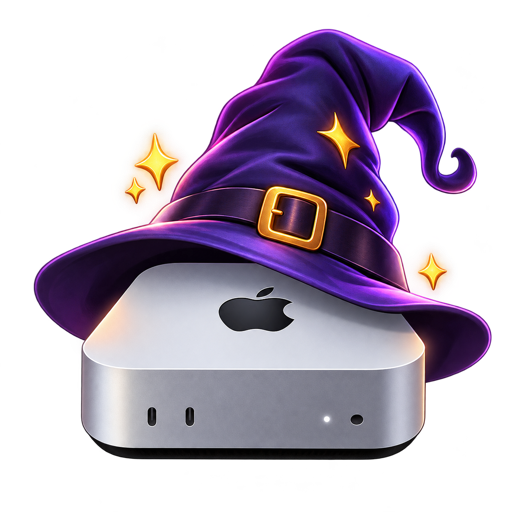
  </a>
</p>

<h1 align="center">witchmymac</h1>

<p align="center"><b>English</b> · <a href="README.pt-BR.md">Português</a></p>

<p align="center">
  <b>Useful spells for your Mac.</b><br>
  Six native Swift apps, 100% free: a Swiss Army knife for the menu bar, a cleaner,<br>
  an archive manager, a notepad, a database client and a remote file client.
</p>

<p align="center">
  
  
  
  
</p>

<p align="center">
  <a href="https://witchmymac.com/"><b>witchmymac.com</b></a> ·
  <a href="#the-apps">The apps</a> ·
  <a href="#installing-on-macos">How to install</a> ·
  <a href="#faq">FAQ</a> ·
  <a href="#about-this-repository">About this repository</a>
</p>

> [!NOTE]
> **No subscription, no ads, no tracking.** These are apps I use every day and decided to share.
> There is no paid version. Each one's source code is open on GitHub.

<p align="center">
  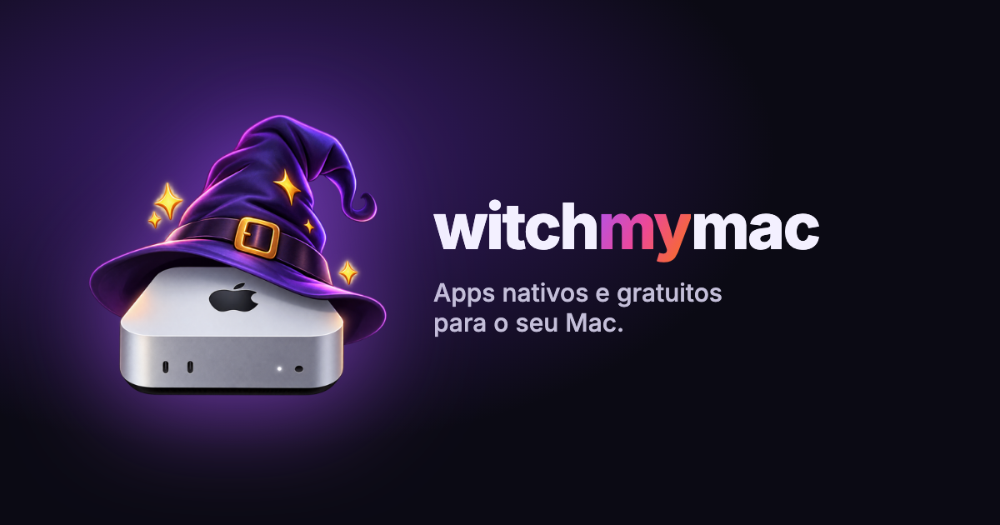
</p>

## The apps

| | App | What it does | Requires | Repository |
|:---:|---|---|---|---|
| 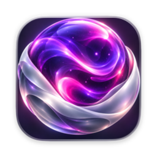 | **[Sirena](#sirena)** | Menu bar utilities: clipboard history, text capture, per-app sound mixer, a Dynamic Island in the notch and more | macOS 26+ | [matthfaria96/Sirena](https://github.com/matthfaria96/Sirena) |
| 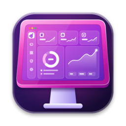 | **[MacDash](#macdash)** | Fearless cleanup and maintenance: nothing is removed without your approval | macOS 13+ | [matthfaria96/MacDash](https://github.com/matthfaria96/MacDash) |
| 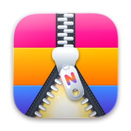 | **[Neorar](#neorar)** | WinRAR-style archive manager: RAR, ZIP, 7Z, TAR, ISO and more | macOS 26+ | [matthfaria96/Neorar](https://github.com/matthfaria96/Neorar) |
| 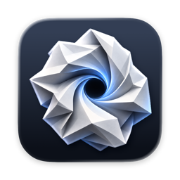 | **[Rubbish Notes](#rubbish-notes)** | A minimalist notepad to clear your head, which saves everything on its own | macOS 26+ | [matthfaria96/rubbish-notes](https://github.com/matthfaria96/rubbish-notes) |
| 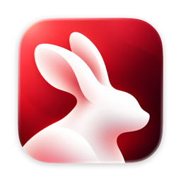 | **[BunnyGrid](#bunnygrid)** | Database client: SQLite, PostgreSQL, MySQL, SQL Server, MongoDB, Redis and more | macOS 14+ | [matthfaria96/BunnyGrid](https://github.com/matthfaria96/BunnyGrid) |
| 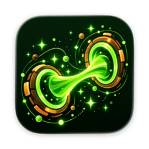 | **[Wormlink](#wormlink)** | Dual-pane remote file client: SFTP, FTP, S3, SMB, WebDAV and cloud drives | macOS 26+ | [matthfaria96/Wormlink](https://github.com/matthfaria96/Wormlink) |

All of them run on Apple Silicon and Intel Macs. Each download is the `.dmg` from the app's latest
GitHub release.

---

###  Sirena

**Your menu bar.** One menu bar icon doing the job of a dozen paid apps. Turn on only the modules
you use.

📋 History · 📌 Pin window · 🔍 Capture text · 📸 Screenshot · 🍅 Pomodoro ·
🎨 Color picker · ✏️ Freehand drawing · 🪞 Camera peek · ☕ Keep screen awake ·
🎚️ Sound mixer · 🪟 Window and Dock · 🙈 Hidden icons · 🗂️ Shelf · 🏝️ Dynamic Island

- **Copy everything, find everything.** A history of what you copy, plus text captured from any image or video.
- **Sound per app.** Each app's volume, where each one plays, and the microphone.
- **The notch comes alive.** Music, calendar, timer and quick controls around the camera.

<p align="center">
  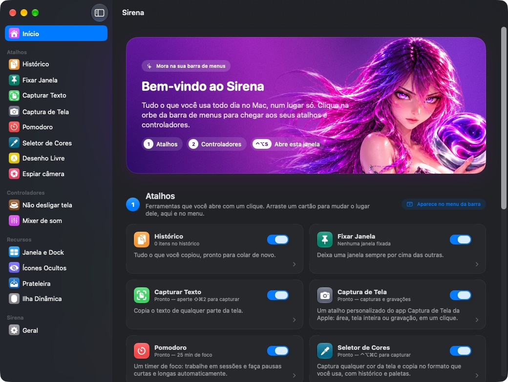
</p>

<p align="center"><a href="https://github.com/matthfaria96/Sirena/releases/latest"><b>Download Sirena</b></a> · <a href="https://github.com/matthfaria96/Sirena">Source code</a> · macOS 26 Tahoe or later</p>

---

###  MacDash

**Your Mac in order.** Cleanup and maintenance without fear. Every scan ends on a review screen,
and nothing is removed without your approval.

- **Smart care.** One scan that gathers system junk, caches, Trash bins and Mail files.
- **Advanced cleanup.** Large files, app leftovers, virtual machines and Xcode, Homebrew, Node and Docker caches.
- **Applications.** Uninstall completely, manage login items and update your apps.
- **Protection and antivirus.** App permissions, security checks, Wi-Fi and browser extensions.
- **Space and duplicates.** Space lens, duplicate files, similar photos and a process monitor.

<p align="center">
  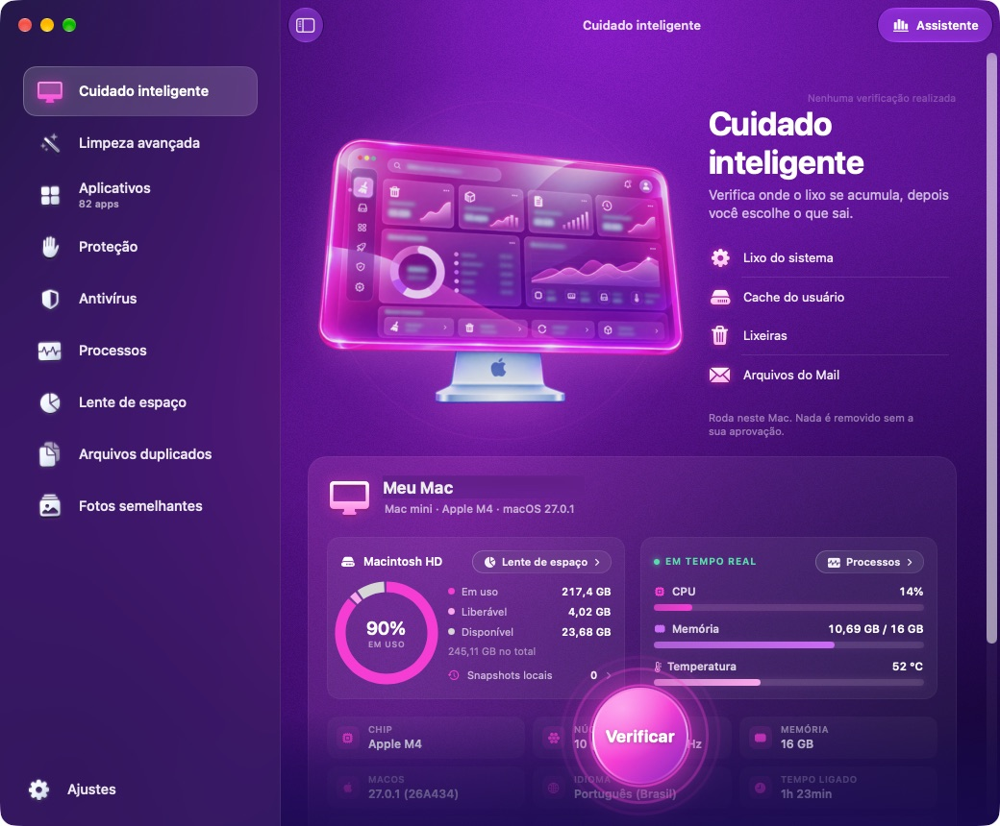
</p>

<p align="center"><a href="https://github.com/matthfaria96/MacDash/releases/latest"><b>Download MacDash</b></a> · <a href="https://github.com/matthfaria96/MacDash">Source code</a> · macOS 13 Ventura or later</p>

---

###  Neorar

**Your archives.** A WinRAR-style archive manager. A single window that starts in Downloads, opens
archives and acts on whatever you select.

- **Extracts everything.** RAR 1.5 to 7 with passwords and volumes, ZIP with AES, 7Z, TAR, ISO, DMG, CAB, MSI and more.
- **Compresses your way.** 7Z, ZIP with AES-256 and TAR, with passwords, split parts and no macOS junk files.
- **Inside the archive.** Browse, search, preview with Quick Look and extract only what you need.
- **Test and repair.** Check integrity and recover damaged RAR and ZIP files.
- **Right from Finder.** Extract and compress from the right-click menu, in five languages.

<p align="center">
  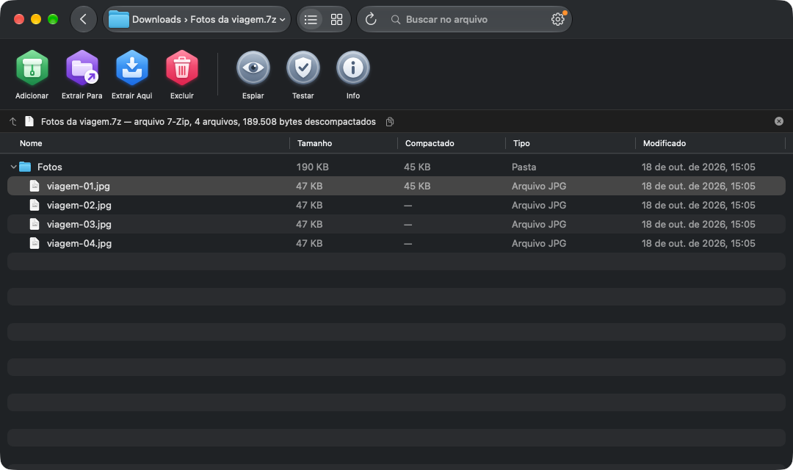
</p>

<p align="center"><a href="https://github.com/matthfaria96/Neorar/releases/latest"><b>Download Neorar</b></a> · <a href="https://github.com/matthfaria96/Neorar">Source code</a> · macOS 26 Tahoe or later</p>

---

###  Rubbish Notes

**A lighter mind.** Get ideas out of your head and move on. A minimalist notepad that saves
everything on its own, on your Mac, as you type. No save button, no account, no cloud: open it,
write, done.

- **Always saves on its own.** Every word is stored a moment after you stop typing, as `.txt` files on your Mac.
- **Focus mode.** Hide everything and keep only the text.
- **Pin what matters, archive the rest.** Pinned notes stay on top, old ones go to the Archive, and everything can be undone with ⌘Z.
- **Themes for your mood.** Dracula, Nord, Tokyo Night, Monokai and more, with light and dark modes and an alternate red icon.
- **Yours alone.** No account, no cloud and no network access. Your notes never leave your Mac.

<p align="center">
  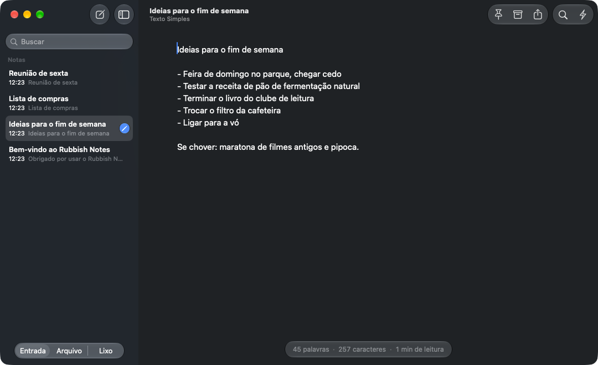
</p>

<p align="center"><a href="https://github.com/matthfaria96/rubbish-notes/releases/latest"><b>Download Rubbish Notes</b></a> · <a href="https://github.com/matthfaria96/rubbish-notes">Source code</a> · macOS 26 Tahoe or later</p>

---

###  BunnyGrid

**Your databases.** A native, lightweight and fast database client. Browse the object tree, open
tables in a paginated grid and write SQL with syntax highlighting and autocomplete.

- **Seven databases, one app.** SQLite, PostgreSQL, MySQL, MariaDB, SQL Server and Azure SQL, MongoDB and Redis.
- **Edit like a spreadsheet.** Grid with cell editing, Form View, row duplication and transactions.
- **Real tools.** Table design, ER diagrams, query plans, backup, automation and BI.
- **Secure connections.** SSL and SSH tunnels, with passwords stored in the macOS Keychain.
- **Optional AI assistant.** Use your own Claude or OpenAI key to write and explain queries.

<p align="center">
  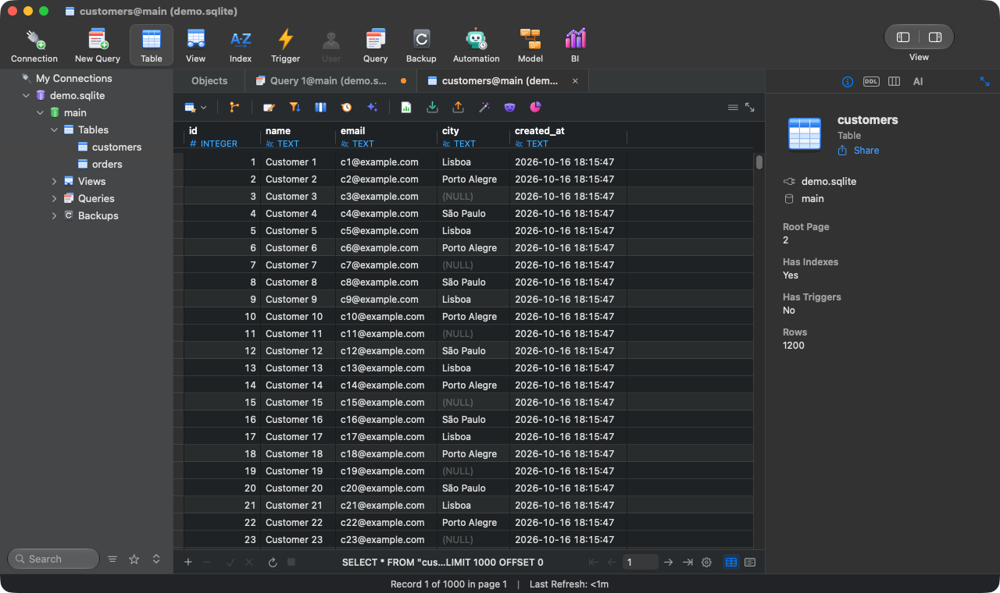
</p>

<p align="center"><a href="https://github.com/matthfaria96/BunnyGrid/releases/latest"><b>Download BunnyGrid</b></a> · <a href="https://github.com/matthfaria96/BunnyGrid">Source code</a> · macOS 14 Sonoma or later</p>

---

###  Wormlink

**Your servers.** Connect. Explore. Transfer. A dual-pane remote file client with the macOS 26
Liquid Glass look, free software under the GPL-3.

- **Every protocol.** SFTP, FTP and FTPS, WebDAV, S3 and compatibles, SMB, Azure, Swift and Backblaze B2.
- **Your clouds.** Dropbox, Google Drive, OneDrive, SharePoint and Box in one place.
- **Worry-free transfers.** Queue, resume, sync with preview, and drag straight from Finder.
- **Mount in Finder.** Wormlink Disk shows your servers as disks in Finder.
- **For terminal people.** SSH keys, ProxyJump, command line and AppleScript.

<p align="center">
  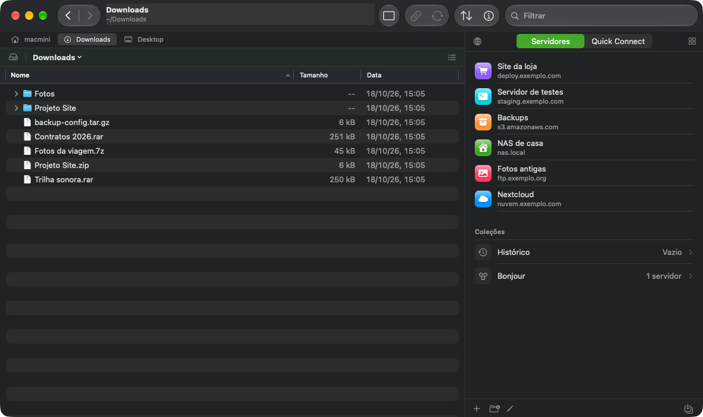
</p>

<p align="center"><a href="https://github.com/matthfaria96/Wormlink/releases/latest"><b>Download Wormlink</b></a> · <a href="https://github.com/matthfaria96/Wormlink">Source code</a> · macOS 26 Tahoe or later</p>

---

## Installing on macOS

Three steps, thirty seconds.

1. **Download the `.dmg`.** In the [apps table](#the-apps), open the app's repository and download
   the `.dmg` from the latest release (or click **Download** on [witchmymac.com](https://witchmymac.com/)).
2. **Drag it to Applications.** Open the `.dmg` and drag the app icon into the **Applications** folder.
3. **Open it.** The first time, macOS asks you to confirm. See below how to allow it.

### First launch: macOS will block the app. That's normal.

The apps are free and don't go through the App Store, so macOS asks you to confirm where they came
from once. After that the app opens normally, for good.

| Step | What to do |
|:---:|---|
| **1** | Open the app. The **"“App” Not Opened"** alert appears. Click **Done** (or **OK**). Never *Move to Trash*. |
| **2** | From the Apple menu (top-left corner), open **System Settings…** |
| **3** | Go to **Privacy & Security** and scroll down to **Security**. It will say *"“App” was blocked to protect your Mac"*. Click **Open Anyway**. |
| **4** | Confirm by clicking **Open Anyway** again and enter your password or use Touch ID. |
| **5** | Done! The app opens. From now on, just open it from Applications or Spotlight. |

> [!TIP]
> The website has an [animated visual guide](https://witchmymac.com/#liberar) showing each of these screens.

<details>
<summary><b>Prefer the Terminal?</b></summary>

After dragging the app into Applications, remove the quarantine flag (replace `Sirena` with the
app's name):

```sh
xattr -dr com.apple.quarantine /Applications/Sirena.app
```

</details>

> [!NOTE]
> **Why does this happen?** Apple charges US$ 99 per year to "notarize" apps. Since these apps are
> free, macOS asks you to confirm their origin once.

### Requirements

| App | Minimum macOS | Processor |
|---|---|---|
| Sirena | 26 Tahoe | Apple Silicon and Intel |
| MacDash | 13 Ventura | Apple Silicon and Intel |
| Neorar | 26 Tahoe | Apple Silicon and Intel |
| Rubbish Notes | 26 Tahoe | Apple Silicon and Intel |
| BunnyGrid | 14 Sonoma | Apple Silicon and Intel |
| Wormlink | 26 Tahoe | Apple Silicon and Intel |

## FAQ

<details>
<summary><b>Is it really free? What's the catch?</b></summary>

No catch. These are apps I use every day and decided to share. There's no paid version,
subscription or ads.
</details>

<details>
<summary><b>Can MacDash delete something important?</b></summary>

Not without you seeing it. Every scan ends on a review screen, and nothing is removed without your approval.
</details>

<details>
<summary><b>Does BunnyGrid's AI assistant send my data anywhere?</b></summary>

Only if you turn it on. It's optional and uses your own Claude or OpenAI key. With no key set up,
nothing leaves your Mac.
</details>

<details>
<summary><b>Why do some apps require macOS 26?</b></summary>

Sirena, Neorar, Rubbish Notes and Wormlink use Liquid Glass and other APIs that only exist from
macOS 26 Tahoe onward.
</details>

<details>
<summary><b>I found a bug or have an idea.</b></summary>

Open an issue in the app's repository (links in the [table](#the-apps)). Every suggestion is welcome.
</details>

## About this repository

This repository is the [witchmymac.com](https://witchmymac.com/) website: plain HTML, CSS and
JavaScript, hosted on GitHub Pages, in English, Portuguese and Spanish. The download buttons fetch
the `.dmg` from each app's latest release (see [apps.js](apps.js)).

To run it locally:

```sh
python3 -m http.server 8000
```

Then open <http://localhost:8000>.
