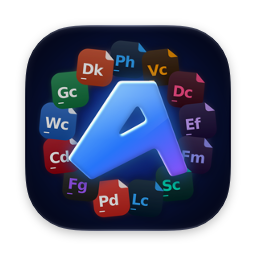
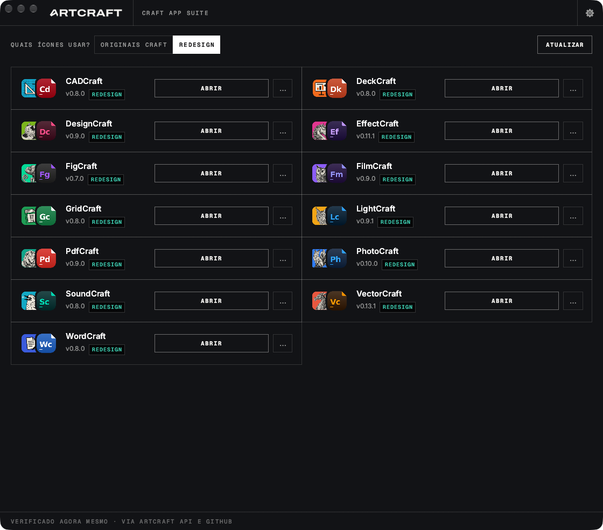

<p align="center">
  <a href="https://witchmymac.com/">
    
  </a>
</p>

<h1 align="center">witchmymac</h1>

<p align="center"><a href="README.md">English</a> · <b>Português</b></p>

<p align="center">
  <b>Feitiços úteis para o seu Mac.</b><br>
  Sete apps nativos, 100% gratuitos: um canivete suíço para a barra de menus, um limpador,<br>
  um compactador de arquivos, um bloco de notas, um cliente de bancos de dados, um cliente de servidores<br>
  e um launcher para os apps Craft.
</p>

<p align="center">
  
  
  
  
</p>

<p align="center">
  <a href="https://witchmymac.com/"><b>witchmymac.com</b></a> ·
  <a href="#os-apps">Os apps</a> ·
  <a href="#como-instalar-no-macos">Como instalar</a> ·
  <a href="#perguntas-frequentes">Perguntas frequentes</a> ·
  <a href="#sobre-este-repositório">Sobre este repositório</a>
</p>

> [!NOTE]
> **Sem assinatura, sem anúncios, sem rastreamento.** São apps que eu uso todo dia e decidi
> compartilhar. Não existe versão paga. O código de cada um está aberto no GitHub.

<p align="center">
  
</p>

## Os apps

| | App | O que faz | Requer | Repositório |
|:---:|---|---|---|---|
|  | **[Sirena](#sirena)** | Utilidades na barra de menus: histórico de cópias, captura de texto, mixer de som por app, Ilha Dinâmica no notch e mais | macOS 15+ | [matthfaria96/Sirena](https://github.com/matthfaria96/Sirena) |
|  | **[MacDash](#macdash)** | Limpeza e manutenção sem medo: nada é removido sem a sua aprovação | macOS 13+ | [matthfaria96/MacDash](https://github.com/matthfaria96/MacDash) |
|  | **[Neorar](#neorar)** | Gerenciador de arquivos compactados no estilo do WinRAR: RAR, ZIP, 7Z, TAR, ISO e outros | macOS 26+ | [matthfaria96/Neorar](https://github.com/matthfaria96/Neorar) |
|  | **[Rubbish Notes](#rubbish-notes)** | Bloco de notas minimalista para esvaziar a cabeça, que salva tudo sozinho | macOS 26+ | [matthfaria96/rubbish-notes](https://github.com/matthfaria96/rubbish-notes) |
|  | **[BunnyGrid](#bunnygrid)** | Cliente de bancos de dados: SQLite, PostgreSQL, MySQL, SQL Server, MongoDB, Redis e mais | macOS 14+ | [matthfaria96/BunnyGrid](https://github.com/matthfaria96/BunnyGrid) |
|  | **[Wormlink](#wormlink)** | Cliente de arquivos remotos em dois painéis: SFTP, FTP, S3, SMB, WebDAV e nuvens | macOS 26+ | [matthfaria96/Wormlink](https://github.com/matthfaria96/Wormlink) |
|  | **[BetterCraft Launcher](#bettercraft-launcher)** | O launcher dos apps Craft repensado: sem ruído visual, direto ao ponto e com ícones redesenhados | macOS 11+ | [matthfaria96/bettercraft-launcher](https://github.com/matthfaria96/bettercraft-launcher) |

Todos rodam em Macs com Apple Silicon e Intel. O download de cada um é o `.dmg` do release mais
recente no GitHub; o BetterCraft Launcher se instala a partir do código fonte.

---

###  Sirena

**Sua barra de menus.** Um ícone na barra de menus fazendo o trabalho de uma dúzia de apps pagos.
Ligue só os módulos que você usa.

📋 Histórico · 📌 Fixar janela · 🔍 Capturar texto · 📸 Captura de tela · 🍅 Pomodoro ·
🎨 Seletor de cores · ✏️ Desenho livre · 🪞 Espiar câmera · ☕ Não desligar tela ·
🖥️ Desligar monitor · 🎚️ Mixer de som · 🪟 Janela e Dock · 🙈 Ícones ocultos · 🗂️ Prateleira · 🏝️ Ilha Dinâmica

- **Copie tudo, ache tudo.** Histórico do que você copia e texto capturado de qualquer imagem ou vídeo.
- **Som por app.** Volume de cada app, para onde cada um toca e o microfone.
- **O notch ganha vida.** Música, calendário, timer e controles rápidos ao redor da câmera.

<p align="center">
  
</p>

<p align="center"><a href="https://github.com/matthfaria96/Sirena/releases/latest"><b>Baixar Sirena</b></a> · <a href="https://github.com/matthfaria96/Sirena">Código fonte</a> · macOS 15 Sequoia ou mais novo</p>

---

###  MacDash

**Seu Mac em ordem.** Limpeza e manutenção sem medo. Toda verificação termina numa tela de revisão,
e nada é removido sem a sua aprovação.

- **Cuidado inteligente.** Uma varredura que junta lixo do sistema, caches, Lixeiras e arquivos do Mail.
- **Limpeza avançada.** Arquivos grandes, restos de apps, máquinas virtuais e caches do Xcode, Homebrew, Node e Docker.
- **Aplicativos.** Desinstale por completo, controle itens de início e atualize seus apps.
- **Proteção e antivírus.** Permissões de apps, verificações de segurança, Wi-Fi e extensões de navegador.
- **Espaço e duplicados.** Lente de espaço, arquivos duplicados, fotos semelhantes e monitor de processos.

<p align="center">
  
</p>

<p align="center"><a href="https://github.com/matthfaria96/MacDash/releases/latest"><b>Baixar MacDash</b></a> · <a href="https://github.com/matthfaria96/MacDash">Código fonte</a> · macOS 13 Ventura ou mais novo</p>

---

###  Neorar

**Seus arquivos compactados.** Um gerenciador de arquivos compactados no estilo do WinRAR. Uma
janela só, que começa em Downloads, entra nos arquivos compactados e age sobre o que você selecionar.

- **Extrai de tudo.** RAR 1.5 a 7 com senha e volumes, ZIP com AES, 7Z, TAR, ISO, DMG, CAB, MSI e outros.
- **Comprime do seu jeito.** 7Z, ZIP com AES-256 e TAR, com senha, partes e sem o lixo do macOS.
- **Dentro do arquivo.** Navegue, busque, espie com Quick Look e extraia só o que precisa.
- **Testar e reparar.** Confira a integridade e recupere arquivos RAR e ZIP danificados.
- **Direto do Finder.** Extrair e comprimir no clique direito, em cinco idiomas.

<p align="center">
  
</p>

<p align="center"><a href="https://github.com/matthfaria96/Neorar/releases/latest"><b>Baixar Neorar</b></a> · <a href="https://github.com/matthfaria96/Neorar">Código fonte</a> · macOS 26 Tahoe ou mais novo</p>

---

###  Rubbish Notes

**Sua mente leve.** Tire as ideias da cabeça e siga em frente. Um bloco de notas minimalista que
salva tudo sozinho, no seu Mac, enquanto você digita. Sem botão de salvar, sem conta, sem nuvem:
abriu, escreveu, pronto.

- **Salva sozinho, sempre.** Cada palavra fica guardada um instante depois que você para de digitar, em arquivos `.txt` no seu Mac.
- **Modo foco.** Esconda tudo e fique só com o texto.
- **Fixe o que importa, arquive o resto.** Notas fixadas ficam no topo, o que já passou vai para o Arquivo e tudo se desfaz com ⌘Z.
- **Temas para o seu humor.** Dracula, Nord, Tokyo Night, Monokai e outros, com modo claro e escuro e um ícone vermelho alternativo.
- **Só seu.** Sem conta, sem nuvem e sem acesso à rede. Suas notas nunca saem do seu Mac.

<p align="center">
  
</p>

<p align="center"><a href="https://github.com/matthfaria96/rubbish-notes/releases/latest"><b>Baixar Rubbish Notes</b></a> · <a href="https://github.com/matthfaria96/rubbish-notes">Código fonte</a> · macOS 26 Tahoe ou mais novo</p>

---

###  BunnyGrid

**Seus bancos de dados.** Um cliente de bancos de dados nativo, leve e rápido. Veja a árvore de
objetos, abra tabelas num grid paginado e escreva SQL com realce de sintaxe e autocompletar.

- **Sete bancos, um app.** SQLite, PostgreSQL, MySQL, MariaDB, SQL Server e Azure SQL, MongoDB e Redis.
- **Editar como planilha.** Grid com edição de células, Form View, duplicar linhas e transações.
- **Ferramentas de verdade.** Design de tabelas, diagrama ER, plano de consulta, backup, automação e BI.
- **Conexões seguras.** SSL e túnel SSH, com senhas guardadas nas Chaves do macOS.
- **Assistente de IA opcional.** Use sua própria chave da Claude ou da OpenAI para escrever e explicar consultas.

<p align="center">
  
</p>

<p align="center"><a href="https://github.com/matthfaria96/BunnyGrid/releases/latest"><b>Baixar BunnyGrid</b></a> · <a href="https://github.com/matthfaria96/BunnyGrid">Código fonte</a> · macOS 14 Sonoma ou mais novo</p>

---

###  Wormlink

**Seus servidores.** Conecte. Explore. Transfira. Um cliente de arquivos remotos em dois painéis,
com o visual Liquid Glass do macOS 26 e software livre sob a GPL-3.

- **Todos os protocolos.** SFTP, FTP e FTPS, WebDAV, S3 e compatíveis, SMB, Azure, Swift e Backblaze B2.
- **Suas nuvens.** Dropbox, Google Drive, OneDrive, SharePoint e Box no mesmo lugar.
- **Transferências sem susto.** Fila, retomada, sincronização com prévia e arrastar direto do Finder.
- **Montar no Finder.** O Wormlink Disk mostra seus servidores como discos no Finder.
- **Para quem vive no terminal.** Chaves SSH, ProxyJump, linha de comando e AppleScript.

<p align="center">
  
</p>

<p align="center"><a href="https://github.com/matthfaria96/Wormlink/releases/latest"><b>Baixar Wormlink</b></a> · <a href="https://github.com/matthfaria96/Wormlink">Código fonte</a> · macOS 26 Tahoe ou mais novo</p>

###  BetterCraft Launcher

**Seus apps Craft.** O launcher do Craft App Suite repensado: sem ruído visual e direto ao ponto.
Uma versão melhorada da experiência do ArtCraft Launcher, com ícones redesenhados.

- **Sem ruído visual.** Uma linha por app: ícone, nome, versão e um botão. Nada de páginas, avisos ou menus sobrando.
- **Ícones redesenhados.** Um clique troca os ícones dos apps Craft no Finder, no Launchpad e no Dock.
- **Atualizações sem surpresa.** Verifica e instala as versões novas sem perder os ícones novos.
- **Sempre em dia.** Acompanha o ArtCraft Launcher original e traz as novidades dele.

<p align="center">
  
</p>

<p align="center"><a href="https://github.com/matthfaria96/bettercraft-launcher"><b>Ver no GitHub</b></a> · macOS 11 Big Sur ou mais novo · instalado a partir do código fonte</p>

---

## Como instalar no macOS

Três passos, trinta segundos.

1. **Baixe o `.dmg`.** Na [tabela de apps](#os-apps), abra o repositório do app e baixe o `.dmg`
   do release mais recente (ou clique em **Baixar** em [witchmymac.com](https://witchmymac.com/)).
2. **Arraste para Aplicativos.** Abra o `.dmg` e arraste o ícone do app para a pasta **Aplicativos**.
3. **Abra e use.** Na primeira vez, o macOS pede uma confirmação. Veja abaixo como liberar.

### Primeira vez abrindo: o macOS vai bloquear o app. É normal.

Os apps são gratuitos e não passam pela App Store, então o macOS pede que você confirme a origem
uma vez. Depois disso o app abre direto, para sempre.

| Passo | O que fazer |
|:---:|---|
| **1** | Abra o app. Aparece o aviso **"“App” não foi aberto"**. Clique em **OK**. Nunca em *Mover para o Lixo*. |
| **2** | No menu da Apple (canto superior esquerdo), abra **Ajustes do Sistema…** |
| **3** | Vá em **Privacidade e Segurança** e role até **Segurança**. Lá estará escrito *"“App” foi bloqueado para proteger o seu Mac"*. Clique em **Abrir Mesmo Assim**. |
| **4** | Confirme clicando em **Abrir Mesmo Assim** de novo e use a sua senha ou o Touch ID. |
| **5** | Pronto! O app abre. Das próximas vezes, é só abrir pela pasta Aplicativos ou pelo Spotlight. |

> [!TIP]
> O site tem um [guia visual animado](https://witchmymac.com/#liberar) com cada uma dessas telas.

<details>
<summary><b>Prefere o Terminal?</b></summary>

Depois de arrastar o app para Aplicativos, remova a marca de quarentena (troque `Sirena` pelo nome
do app):

```sh
xattr -dr com.apple.quarantine /Applications/Sirena.app
```

</details>

> [!NOTE]
> **Por que isso acontece?** A Apple cobra US$ 99 por ano para "autenticar" apps. Como os apps são
> gratuitos, o macOS pede que você confirme a origem uma única vez.

### Requisitos

| App | macOS mínimo | Processador |
|---|---|---|
| Sirena | 15 Sequoia | Apple Silicon e Intel |
| MacDash | 13 Ventura | Apple Silicon e Intel |
| Neorar | 26 Tahoe | Apple Silicon e Intel |
| Rubbish Notes | 26 Tahoe | Apple Silicon e Intel |
| BunnyGrid | 14 Sonoma | Apple Silicon e Intel |
| Wormlink | 26 Tahoe | Apple Silicon e Intel |
| BetterCraft Launcher | 11 Big Sur | Apple Silicon e Intel |

## Perguntas frequentes

<details>
<summary><b>É mesmo de graça? Qual é o truque?</b></summary>

Nenhum truque. São apps que eu uso todo dia e decidi compartilhar. Não há versão paga, assinatura
nem anúncios.
</details>

<details>
<summary><b>O MacDash pode apagar algo importante?</b></summary>

Não sem você ver. Toda verificação termina numa tela de revisão, e nada é removido sem a sua aprovação.
</details>

<details>
<summary><b>O assistente de IA do BunnyGrid envia meus dados?</b></summary>

Só se você ligar. Ele é opcional e usa a sua própria chave da Claude ou da OpenAI. Sem chave
configurada, nada sai do seu Mac.
</details>

<details>
<summary><b>Por que alguns apps pedem macOS 26?</b></summary>

O Neorar, o Rubbish Notes e o Wormlink usam o Liquid Glass e outras APIs que só existem
a partir do macOS 26 Tahoe. O Sirena se adapta: no macOS 15 Sequoia ele troca o Liquid Glass
pelo visual translúcido clássico do sistema.
</details>

<details>
<summary><b>Encontrei um bug ou tenho uma ideia.</b></summary>

Abra uma issue no repositório do app (links na [tabela](#os-apps)). Toda sugestão é bem-vinda.
</details>

## Sobre este repositório

Este repositório é o site [witchmymac.com](https://witchmymac.com/): HTML, CSS e JavaScript puros,
hospedado no GitHub Pages, em português, inglês e espanhol. Os botões de download buscam o `.dmg`
do release mais recente de cada app (veja [apps.js](apps.js)).

Para rodar localmente:

```sh
python3 -m http.server 8000
```

E abra <http://localhost:8000>.
